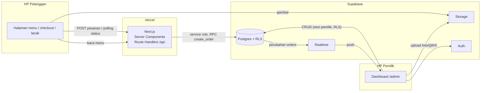
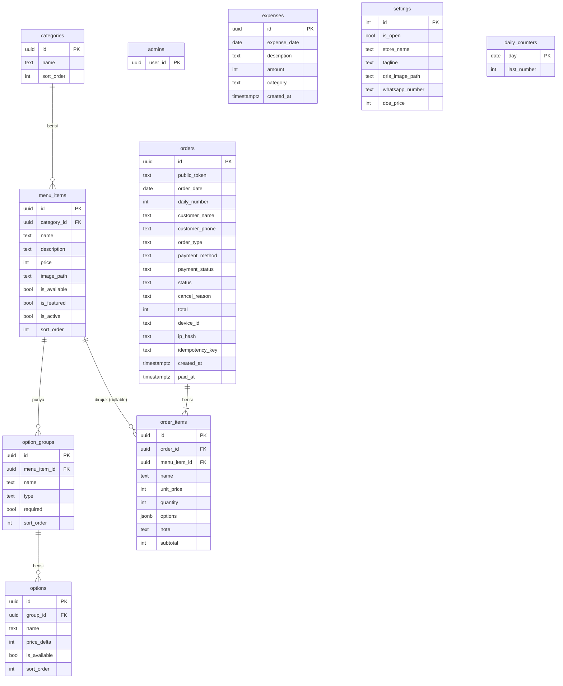

# Arsitektur — Rumah Makan Sipil

Dokumen terkait: [PRD](PRD.md) · [User Flows](user-flows.md) · [Roadmap](roadmap.md)

---

## 1. Tech stack

| Lapisan | Pilihan | Alasan |
|---|---|---|
| Framework | **Next.js (App Router) + TypeScript** | Satu aplikasi untuk halaman pelanggan + dashboard + API, SSR cepat di HP |
| UI | **Tailwind CSS + shadcn/ui** (Radix + Lucide) | Komponen siap pakai yang mudah diberi warna brand, aksesibel |
| Database | **Supabase Postgres** | Gratis untuk skala satu warung, SQL penuh untuk laporan |
| Auth | **Supabase Auth** (email + password, 1 akun) | Tidak perlu membuat sistem login sendiri |
| Realtime | **Supabase Realtime** (Postgres Changes) | Pesanan baru langsung muncul di dashboard |
| File | **Supabase Storage** | Foto menu & gambar QRIS |
| Validasi | **Zod** | Satu skema untuk form dan server |
| QR | **`qrcode`** (npm) | Membuat QR untuk poster |
| Hosting | **Vercel** (paket gratis, domain `*.vercel.app`) | Deploy otomatis dari GitHub |

Zona waktu bisnis: **Asia/Makassar (WITA)**. Semua timestamp disimpan `timestamptz` (UTC), dan pengelompokan per hari dilakukan di WITA.

## 2. Gambaran sistem



Prinsip keamanan utama:

- **Pelanggan tidak pernah menulis langsung ke database.** Semua lewat Route Handler Next.js, yang memanggil fungsi Postgres `create_order` dengan *service role key* (hanya ada di server).
- **Harga dihitung ulang di server** dari tabel menu. Harga dari HP pelanggan diabaikan.
- **Pemilik** mengakses data langsung dengan sesi login, dan dibatasi oleh **RLS**.

## 3. Struktur folder

```
rumah-makan-sipil/
├─ app/
│  ├─ (pelanggan)/
│  │  ├─ page.tsx                  # menu
│  │  ├─ keranjang/page.tsx
│  │  ├─ checkout/page.tsx
│  │  └─ pesanan/[token]/page.tsx  # lacak pesanan
│  ├─ admin/
│  │  ├─ login/page.tsx
│  │  ├─ layout.tsx                # cek sesi + navigasi
│  │  ├─ page.tsx                  # pesanan live
│  │  ├─ menu/…  riwayat/…  laporan/…  keuangan/…  qr/…  pengaturan/…
│  └─ api/
│     ├─ admin/
│     │  ├─ orders/[id]/
│     │  │  └─ route.ts            # PATCH aksi pesanan (mulai_masak, siap, selesai, lunas, batal, dll)
│     │  └─ settings/
│     │     └─ route.ts            # GET & PATCH status buka/tutup toko
│     └─ orders/
│        ├─ route.ts               # POST buat pesanan
│        └─ [token]/
│           ├─ route.ts            # GET status pesanan (publik, via token)
│           └─ claim-paid/route.ts # POST "Saya sudah bayar"
├─ components/
│  ├─ ui/                          # shadcn/ui
│  ├─ pelanggan/                   # MenuCard, OptionSheet, CartBar, …
│  └─ admin/                       # OrderCard, StatusBadge, StatCard, …
├─ lib/
│  ├─ supabase/                    # public.ts (anon, server-only); browser/service menyusul di M2–M3
│  ├─ menu.ts                      # getMenu(): menu aktif + pengaturan, per request (server-only)
│  ├─ cart.ts                      # logika keranjang murni (gabung baris, harga, validasi pilihan)
│  ├─ use-cart.ts                  # store keranjang di localStorage (useSyncExternalStore)
│  ├─ format.ts                    # formatRupiah, formatWaktu (WITA) + format.test.ts (Vitest, di samping file)
│  └─ schemas.ts                   # skema Zod
├─ supabase/
│  ├─ migrations/                  # skema, RLS, fungsi SQL
│  ├─ seed.sql                     # data dari menu-seed.md
│  └─ tests/                       # pgTAP untuk fungsi SQL
├─ e2e/                            # tes Playwright (viewport HP)
├─ public/                         # logo, ikon, suara notifikasi
└─ docs/
```

## 4. Skema database



Catatan kolom:

| Kolom | Aturan |
|---|---|
| Semua harga/nominal | `integer` Rupiah, `check (>= 0)` |
| `option_groups.type` | `'single'` (pilih satu, radio) / `'multiple'` (tambahan, checkbox) |
| `menu_items.is_active` | `false` = disembunyikan (hapus lunak), agar riwayat pesanan tetap utuh |
| `menu_items.is_featured` | `true` = menu unggulan, tampil sebagai banner di halaman pelanggan (D12). Default `false`; diubah lewat toggle cepat `PATCH /api/admin/menu/[id]` `{ is_featured }` |
| `orders.order_type` | `'dine_in'` / `'takeaway'` |
| `orders.payment_method` | `'qris'` / `'cash'` |
| `orders.payment_status` | `'belum_bayar'` / `'menunggu_verifikasi'` / `'lunas'` |
| `orders.status` | `'baru'` / `'dimasak'` / `'siap'` / `'selesai'` / `'batal'` |
| `orders.public_token` | String acak ≥ 22 karakter (unik), dipakai di link lacak. **Bukan** `id`, supaya tidak bisa ditebak |
| `orders (order_date, daily_number)` | `unique` |
| `orders.idempotency_key` | `unique`, dibuat di HP saat checkout untuk mencegah pesanan ganda |
| `order_items.name`, `unit_price`, `options` | **Salinan** saat memesan (mis. `[{"group":"Pilihan","name":"Goreng","price_delta":0}]`), sehingga perubahan menu tidak mengubah riwayat |
| `expenses.category` | `'bahan'` / `'operasional'` / `'lainnya'` |
| `settings` | Satu baris saja (`id = 1`, `check (id = 1)`) |
| `ip_hash` | Hash SHA-256 IP + salt, bukan IP mentah (privasi) |

Index: `orders (order_date desc, status)`, `orders (device_id, created_at)`, `orders (ip_hash, created_at)`, `order_items (order_id)`, `expenses (expense_date)`.

## 5. Fungsi kunci

### 5.1 `create_order(payload jsonb, device_id text, ip_hash text)` — Postgres, `security definer`

Hanya bisa dipanggil oleh *service role* (`revoke execute … from anon, authenticated`). Dalam **satu transaksi**:

1. Jika `idempotency_key` sudah ada → kembalikan pesanan yang sama.
2. Tolak jika `settings.is_open = false`.
3. **Rate limit**: tolak jika sudah ada ≥ 3 pesanan dari `device_id` **atau** `ip_hash` yang sama dalam 10 menit terakhir.
4. Validasi item: menu & opsi ada, `is_active`, `is_available`, opsi milik menu tersebut, grup `required` terisi, grup `single` maks. 1 pilihan, jumlah 1–20, maks. 30 baris.
5. Hitung `unit_price = price + Σ price_delta`, `subtotal`, dan `total` dari database.
6. Ambil nomor harian:
   ```sql
   insert into daily_counters (day, last_number)
   values ((now() at time zone 'Asia/Makassar')::date, 1)
   on conflict (day) do update set last_number = daily_counters.last_number + 1
   returning last_number;
   ```
   Baris counter terkunci selama transaksi, jadi dua pesanan bersamaan tidak bisa mendapat nomor yang sama.
7. Insert `orders` + `order_items`, lalu kembalikan `{ public_token, daily_number, total }`.

Error dikembalikan dengan kode yang jelas (`STORE_CLOSED`, `ITEM_UNAVAILABLE` + daftar id, `RATE_LIMITED`, `INVALID_ITEM`), dan Route Handler menerjemahkannya ke pesan berbahasa Indonesia.

### 5.2 `claim_paid(token)` dan `get_order(token)`

- `claim_paid`: hanya jika `payment_method = 'qris'` dan `payment_status = 'belum_bayar'`, lalu ubah ke `menunggu_verifikasi`.
- `get_order`: kembalikan data pesanan yang aman untuk publik (tanpa `device_id`, `ip_hash`, `customer_phone`).

### 5.3 Laporan & keuangan (fungsi SQL, hanya pemilik)

- `report_summary(from date, to date)`: omzet, jumlah pesanan, Cash vs QRIS (hanya `lunas` & bukan `batal`).
- `top_items(from, to, limit)`: menu terlaris berdasarkan jumlah porsi.
- `cashbook(from, to)`: per tanggal → pemasukan, pengeluaran, laba kotor.

### 5.4 `reorder_categories(p_items jsonb)` dan `reorder_menu_items(p_items jsonb)` — Postgres, `security definer`

Hanya bisa dipanggil oleh akun pemilik (`public.is_owner()`). Dalam **satu transaksi atomik**:
1. Memvalidasi format array `p_items`.
2. Memperbarui `sort_order` setiap baris secara berurutan.
3. Jika terdapat ID yang tidak ditemukan atau tidak aktif, membatalkan (*rollback*) seluruh perubahan dan melempar error `P0002`.

## 6. Keamanan (RLS)

RLS **aktif di semua tabel**. Pendaftaran user baru di Supabase Auth **dimatikan**, dan akun pemilik dibuat manual satu kali.

```sql
-- pemilik = user yang id-nya tercatat di tabel admins
create function is_owner() returns boolean
language sql stable security definer as
$$ select exists (select 1 from admins where user_id = auth.uid()) $$;
```

| Tabel | anon (pelanggan) | pemilik (`is_owner()`) |
|---|---|---|
| `categories` | `select` semua | semua |
| `menu_items` | `select` jika `is_active` | semua |
| `option_groups`, `options` | `select` jika menu induknya `is_active` | semua |
| `settings` | `select` (semua kolomnya memang data publik toko) | `update` |
| `orders`, `order_items` | **tidak ada** (hanya via fungsi di server) | semua |
| `expenses`, `daily_counters`, `admins` | tidak ada | semua (`admins`: select) |

Storage:

- Bucket `menu-photos` dan `store` (QRIS, logo): **baca publik**, tulis hanya pemilik.
- Foto dikompres di browser sebelum upload (dipotong 4:3, maks. 1200×900, WebP ~80%), sehingga tidak perlu library pengolah gambar di server.

Lain-lain:

- `SUPABASE_SERVICE_ROLE_KEY` hanya ada di environment server Vercel, tidak pernah memakai prefiks `NEXT_PUBLIC_`.
- Semua input pelanggan divalidasi Zod di Route Handler, lalu divalidasi ulang di SQL.
- Nama & catatan pelanggan ditampilkan sebagai teks biasa (React sudah meng-escape), tidak pernah sebagai HTML.

## 7. Realtime & notifikasi

- **Dashboard**: subscribe Supabase Realtime `postgres_changes` pada tabel `orders` (sesi pemilik, sehingga RLS berlaku). Saat ada `INSERT`, dashboard memutar bunyi `public/sounds/pesanan-baru.mp3`, menampilkan kartu baru, dan mengambil `order_items`-nya.
  - Bunyi butuh satu interaksi pengguna (aturan autoplay browser), jadi ada tombol **"Aktifkan suara"**.
  - **Screen Wake Lock API** menjaga layar HP tetap menyala selama dashboard terbuka (jika didukung).
  - Saat koneksi tersambung kembali, data dimuat ulang penuh agar tidak ada pesanan terlewat.
- **Halaman lacak pelanggan**: **polling** `GET /api/orders/[token]` setiap 5 detik selama tab terlihat (berhenti saat status `selesai`/`batal`).
  `shortcut: polling, bukan realtime, karena pelanggan tidak punya sesi untuk RLS; ganti ke Realtime Broadcast jika beban polling terasa.`

## 8. Keranjang & data di HP pelanggan

`localStorage` menyimpan:

- `cart`: daftar item (`menu_item_id`, opsi terpilih, catatan, jumlah)
- `device_id`: UUID acak yang dibuat sekali, untuk rate limit
- `active_orders`: token pesanan hari ini, untuk banner "Pesanan aktif kamu"

Semua akses dibungkus `try/catch`, sehingga aplikasi tetap berjalan jika `localStorage` tidak tersedia.

## 9. Environment & deploy

| Variabel | Lokasi |
|---|---|
| `NEXT_PUBLIC_SUPABASE_URL`, `NEXT_PUBLIC_SUPABASE_ANON_KEY` | publik |
| `SUPABASE_SERVICE_ROLE_KEY` | server saja |
| `IP_HASH_SALT` | server saja |
| `NEXT_PUBLIC_SITE_URL` | publik (dipakai untuk QR poster) |

Alur deploy: push ke `main` di GitHub → Vercel build otomatis. Migrasi DB dijalankan dengan `supabase db push`, dan setiap Pull Request mendapat Preview URL dari Vercel.

## 10. Pengujian

| Lapisan | Alat | Cakupan minimum |
|---|---|---|
| SQL | pgTAP (`supabase test db`) | `create_order`: harga dihitung server, nomor harian berurutan & reset, menu habis ditolak, toko tutup ditolak, rate limit, idempotensi. RLS: anon tidak bisa baca `orders` |
| Unit | Vitest | `formatRupiah`, hitung total keranjang, skema Zod |
| E2E | Playwright (viewport HP) | Pesan → QRIS → "Sudah bayar" → pemilik Lunas → Siap → pelanggan melihat "Siap". Berjalan di CI terhadap Supabase **lokal** (`supabase start`); tes yang mengubah data otomatis di-skip bila URL bukan localhost |
