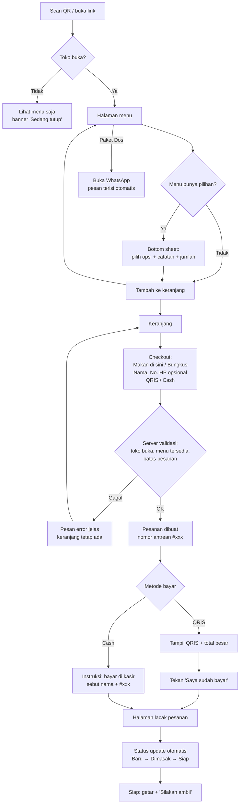
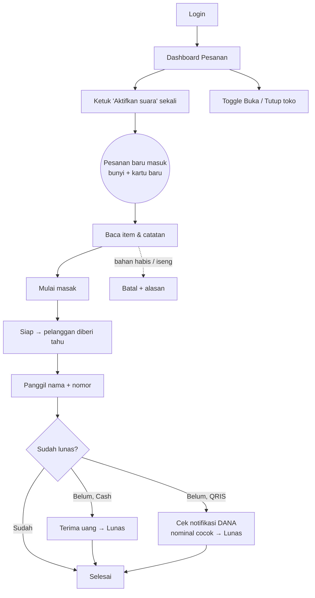
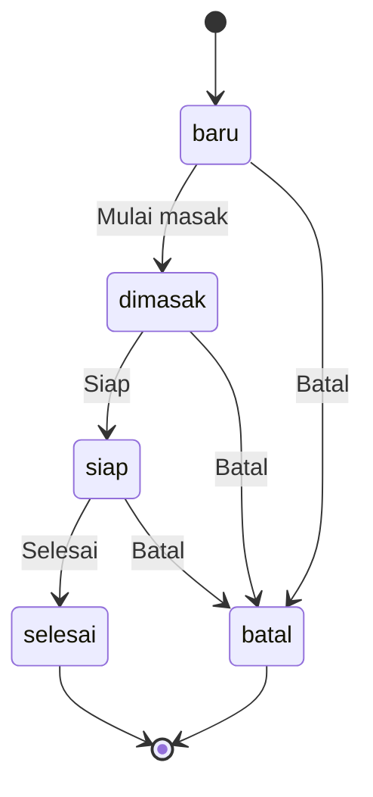
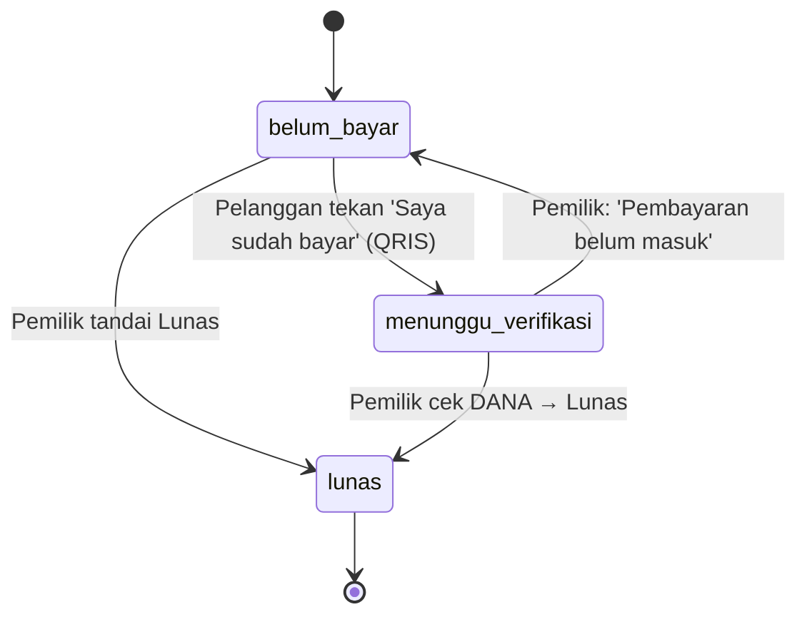

# User Flows — Rumah Makan Sipil

Dokumen terkait: [PRD](PRD.md) · [Design System](design-system.md) · [Arsitektur](architecture.md)

---

## 1. Alur pelanggan

## 2. Alur pemilik

Catatan: tombol **Lunas** bisa ditekan kapan saja (sebelum, saat, atau sesudah memasak). Urutan di diagram hanya urutan yang paling umum.

## 3. Status pesanan (masak)

## 4. Status bayar

## 5. Daftar layar

### Pelanggan (rute publik)

| Rute | Layar | Isi utama |
|---|---|---|
| `/` | Menu | Header (logo, tagline, status buka/tutup), banner geser (Paket Dos, cara pesan, cara bayar), tab kategori, kartu menu, bar keranjang |
| (sheet) | Detail/pilihan menu | Opsi, catatan, jumlah, tombol Tambah |
| `/keranjang` | Keranjang | Daftar item, ubah jumlah, total, tombol Lanjut |
| `/checkout` | Checkout | Jenis pesanan, nama, no. HP, metode bayar, ringkasan, tombol Pesan Sekarang |
| `/pesanan/[token]` | Lacak pesanan | Nomor antrean besar, status masak & bayar, item, total, QRIS (jika belum bayar & QRIS), tombol "Saya sudah bayar" |

### Pemilik (rute `/admin`, wajib login)

| Rute | Layar | Isi utama |
|---|---|---|
| `/admin/login` | Login | Email, password |
| `/admin` | Pesanan live | Toggle buka/tutup, tombol suara, filter/kanban Baru · Dimasak · Siap, kartu pesanan |
| `/admin/menu` | Kelola menu | Daftar per kategori, toggle Habis, urutkan, tambah menu |
| `/admin/menu/[id]` | Form menu | Nama, kategori, harga, deskripsi, foto, grup pilihan & opsi |
| `/admin/riwayat` | Riwayat | Filter tanggal, daftar pesanan, detail |
| `/admin/laporan` | Laporan | Kartu statistik hari ini/bulan ini, menu terlaris, Cash vs QRIS |
| `/admin/keuangan` | Catatan keuangan | Buku kas per tanggal (pemasukan, pengeluaran, laba kotor), tambah pengeluaran |
| `/admin/qr` | Poster QR | Pratinjau poster, Cetak, Unduh PNG |
| `/admin/pengaturan` | Pengaturan | Nama & tagline, gambar QRIS, nomor WhatsApp, harga Paket Dos, ganti password |

## 6. Kasus khusus

| Situasi | Perilaku |
|---|---|
| Menu habis saat pelanggan sedang checkout | Server menolak, menandai item yang habis di keranjang, dan pelanggan bisa menghapusnya lalu mengirim ulang |
| Toko ditutup saat pelanggan checkout | Server menolak dengan pesan "Maaf, toko baru saja tutup" |
| Pelanggan menutup browser | Link lacak tersimpan di `localStorage`, dan halaman menu menampilkan banner "Pesanan aktif kamu #007 →" |
| Pelanggan menekan Pesan dua kali | Tombol nonaktif saat mengirim, dan server memakai *idempotency key* agar tidak terbuat pesanan ganda |
| Batas pesanan terlampaui | Pesan "Terlalu banyak pesanan dari perangkat ini, coba lagi beberapa menit lagi" |
| Dashboard kehilangan koneksi | Banner "Koneksi terputus, mencoba menyambung…", lalu data dimuat ulang otomatis setelah tersambung |
| Pesanan dibatalkan | Halaman lacak pelanggan menampilkan "Pesanan dibatalkan" + alasan (jika ada) |
